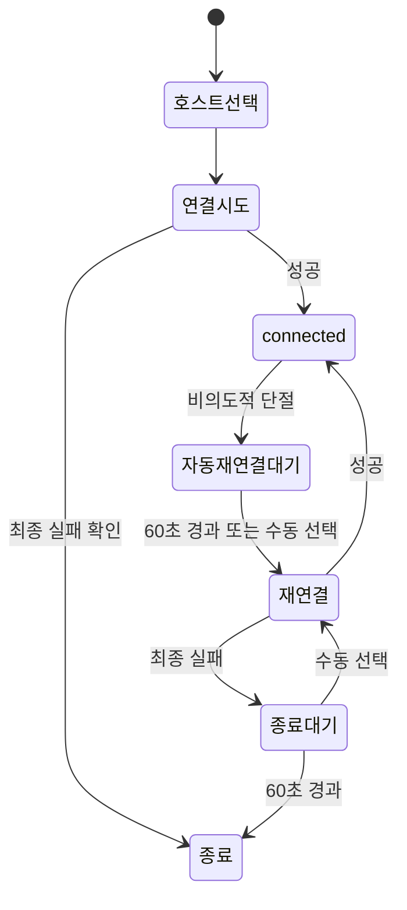

# LocalForwarder

시스템 OpenSSH를 사용하는 작은 네이티브 SSH local forwarding GUI입니다. macOS는 Swift/AppKit, Windows는 C++/Win32로 구현합니다. SSH 프로토콜과 실제 데이터 전송은 OS의 `ssh`가 담당합니다.

## 지원 환경과 다운로드

| OS | CPU | 파일 |
|---|---|---|
| macOS 15 이상 | Apple Silicon ARM64 | `LocalForwarder-macos-arm64.zip` |
| Windows 11 | x64 | `LocalForwarder-windows-x64.zip` |
| Windows 11 | ARM64 | `LocalForwarder-windows-arm64.zip` |

[GitHub Actions](https://github.com/GuruJung/LocalForwarder/actions/workflows/build.yml)의 성공한 실행을 열고 **Artifacts**에서 해당 CPU의 파일을 다운로드하세요. Actions 결과물 다운로드에는 GitHub 로그인이 필요하며 결과물은 7일간 보관됩니다. Artifact ZIP 안의 배포 ZIP도 풀어 macOS에서는 `.app`, Windows에서는 `.exe`를 실행합니다.

첫 버전은 무료 배포를 위해 macOS ad-hoc 서명과 Windows 인증서 없는 실행 파일을 사용합니다. macOS가 앱 실행을 차단하면 출처를 확인한 뒤 시스템 설정의 개인정보 보호 및 보안에서 허용할 수 있습니다. Windows에서는 SmartScreen 경고가 나타날 수 있습니다. 조직 정책이 실행을 금지한다면 관리자의 정책을 따르세요.

Windows에는 **OpenSSH Client** 선택적 기능이 필요합니다. 앱은 Windows 시스템 OpenSSH를 사용하며 Git for Windows의 SSH나 별도의 SSH 구현을 설치하지 않습니다. macOS에서는 `/usr/bin/ssh`를 사용합니다.

## 사용 방법

1. 호스트를 추가하고 이름과 SSH 별칭 또는 주소를 입력합니다. 기존 `~/.ssh/config`의 별칭을 그대로 사용할 수 있습니다.
2. 필요할 때만 사용자명, SSH 포트, 개인키 경로를 지정합니다. 빈 항목은 SSH 기본 설정을 따릅니다.
3. 로컬 포트, 목적지 호스트, 목적지 포트를 규칙으로 추가하고 사용할 규칙을 활성화합니다.
4. 저장하고 연결합니다. 성공하면 창이 숨겨지고 트레이 또는 macOS 메뉴바에 아이콘이 나타납니다.
5. 아이콘의 메뉴에서 설정을 다시 열거나 종료할 수 있습니다.

예를 들어 `15432 → 127.0.0.1:5432`는 내 컴퓨터의 `127.0.0.1:15432`를 **SSH 서버에서 보는** `127.0.0.1:5432`로 연결합니다. 목적지 호스트는 SSH 서버 기준입니다.

앱이 추가하는 규칙은 내 컴퓨터의 IPv4 루프백 `127.0.0.1`에서만 접속을 받습니다. 기존 SSH 설정에 있는 `LocalForward`, `RemoteForward`, `DynamicForward`도 읽기 전용으로 표시하며 함께 실행됩니다. 이 기존 규칙의 바인딩 범위는 원래 SSH 설정을 따릅니다.

앱을 여러 번 실행해 서로 다른 호스트에 연결할 수 있습니다. 각 인스턴스는 별도 아이콘과 SSH 프로세스를 가집니다. SSH가 포트 점유로 바인딩에 실패하면 새 연결 전체가 실패합니다.

Windows 기본 OpenSSH는 포트 재사용을 허용하므로 같은 로컬 포트의 두 인스턴스가 모두 연결될 수 있습니다. 이 경우 트래픽이 어느 인스턴스로 전달될지 보장되지 않으므로 인스턴스마다 다른 로컬 포트를 지정하세요. 앱은 중복 검사 없이 시스템 SSH의 실행 결과를 따릅니다. [Windows 소켓 재사용 동작](https://learn.microsoft.com/en-us/windows/win32/winsock/using-so-reuseaddr-and-so-exclusiveaddruse)

## 연결 상태와 자동 재연결



각 연결 작업은 첫 실패 후 **1초 뒤 한 번 더** 시도합니다. 자동 재연결이 최종 실패하면 추가 자동 반복 없이 60초 후 종료합니다. 성공한 뒤 다시 단절되면 새로운 주기가 시작됩니다. 사용자가 종료하면 예약을 취소하고 해당 인스턴스의 SSH도 정리합니다.

단절 대기 중 메뉴에는 **재연결**이 추가됩니다. 수동 재연결은 기존 예약을 대신하고, 실패하면 종료까지 다시 60초를 기다립니다. 자동 실패는 창이나 인증 터미널을 강제로 띄우지 않습니다. 설정 화면에서 원인을 확인할 수 있습니다.

네트워크가 끊긴 시점과 SSH가 이를 감지한 시점은 다릅니다. SSH keepalive 기본값은 15초 간격·3회이며, 60초 대기는 **단절 감지 이후**부터 시작합니다. 절전 시간도 대기에 포함됩니다.

`connected`는 SSH와 포워딩 개설 상태를 뜻합니다. DB나 웹 서비스 자체의 응답 여부는 검사하지 않습니다. 목적지 서비스가 내려가도 SSH가 유지되면 connected를 유지합니다.

## 설정 파일

두 OS 모두 실제 사용자 홈의 `.LocalForwarder/config.json`을 사용합니다. 실행 파일 옆에 설정을 두지 않습니다.

```json
{
  "version": 1,
  "hosts": [
    {
      "id": "development",
      "name": "개발 서버",
      "target": "dev-server",
      "forwards": [
        {
          "id": "database",
          "enabled": true,
          "localPort": 15432,
          "remoteHost": "127.0.0.1",
          "remotePort": 5432
        }
      ]
    }
  ]
}
```

호스트의 선택 필드는 `user`(문자열), `port`(정수), `identityFile`(문자열)입니다. 호스트와 규칙의 ID는 고유한 영문·숫자·하이픈·밑줄 식별자를 사용합니다.

설정을 열거나 연결할 때마다 파일을 다시 읽습니다. 저장은 즉시 수행하며 변경 충돌 검사는 없습니다. 동일 항목은 마지막 저장이 반영됩니다. 연결 중 저장하면 다음 연결부터 적용할지, 즉시 끊고 재연결할지 선택합니다. 다음 연결에는 자동 재연결도 포함됩니다.

손상된 설정 파일은 자동으로 덮어쓰지 않습니다. 오류 내용을 확인하고 파일을 복구한 뒤 다시 실행하세요. 개인키 내용과 비밀번호는 JSON에 저장하지 않습니다.

## 인증 준비와 복구

평상시 연결은 콘솔과 입력 없이 동작하므로 비대화형 인증이 가능해야 합니다. 인증이나 최초 호스트 신뢰 확인이 필요하면 앱이 설명한 다음 외부 터미널의 복구 도우미로 넘기고 종료합니다. 자동 재연결 실패 후에는 설정 화면에서 직접 복구를 선택합니다.

복구 도우미는 기존 키를 우선 사용합니다. 필요한 경우 암호 없는 Ed25519 키를 사용자 홈의 `.LocalForwarder/keys/`에 만들고, 일반 Linux/macOS 원격 계정의 `~/.ssh/authorized_keys`에 공개키를 추가합니다. 기존 파일을 보존하고 같은 키는 중복 등록하지 않습니다. 비밀번호와 기존 개인키 암호는 터미널에서만 입력합니다.

등록 후 입력 없는 접속을 검증합니다. 성공하면 앱을 다시 실행하세요. 서버가 공개키 인증을 허용하지 않거나 MFA를 요구한다면 관리자 설정이 필요합니다. 변경된 호스트 키는 자동 삭제하거나 검증을 우회하지 않습니다. 원격 Windows 계정의 자동 공개키 등록은 지원 범위 밖이며, 이미 인증이 준비된 Windows SSH 서버에는 연결할 수 있습니다.

## 빌드와 테스트

GitHub 공개 저장소의 표준 macOS·Windows 러너를 사용합니다. 사용자의 Windows PC에 MSVC나 CMake를 설치할 필요 없이 Actions에서 빌드 결과를 받을 수 있습니다.

Mac에 Xcode가 있다면 저장소 루트에서 다음 명령으로 빌드·테스트합니다.

```sh
bash scripts/eval-macos.sh
```

Windows에서 로컬 빌드를 원한다면 C++ 데스크톱 개발 도구가 포함된 Visual Studio/Build Tools와 CMake, Ninja, Python, 테스트용 OpenSSH Server가 필요합니다. 개인 개발자는 Visual Studio Community를 사용할 수 있습니다.

```powershell
pwsh -NoProfile -File scripts/eval-windows.ps1 -Architecture x64
# ARM64 Windows에서는 -Architecture arm64
```

실제 SSH 통합 테스트는 임시 키·설정·루프백 서버만 사용합니다. macOS에서는 격리된 테스트 sshd 실행을 위해 sudo 권한이 필요할 수 있습니다. Windows CI의 테스트용 SSH 서버 준비 스크립트는 일회성 GitHub 러너에서만 동작하며 앱에 SSH 서버를 포함하지 않습니다.

검증에는 실제 60초 대기 시나리오와 60초 유휴 자원 측정이 포함되므로 몇 분이 걸립니다. CI의 evidence 결과물에 실행 결과와 측정값을 기록합니다. 실제 데스크톱의 시각적 확인 여부는 자동 테스트 성공과 별도로 보고합니다.

## 라이선스와 명세

[MIT License](LICENSE). Windows JSON 처리는 [yyjson](third_party/yyjson/README.md)을 사용하며 해당 라이선스를 보존합니다.

[현재 기능 명세](docs/dev-plans/current-spec.md) · [승인된 기능 명세](docs/dev-plans/specs/20261111-localforwarder-v1/spec.md)
